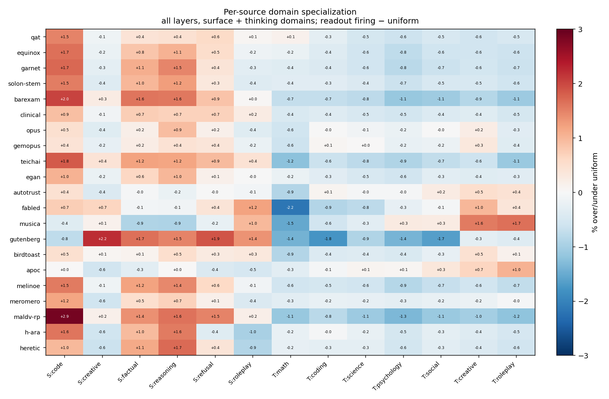
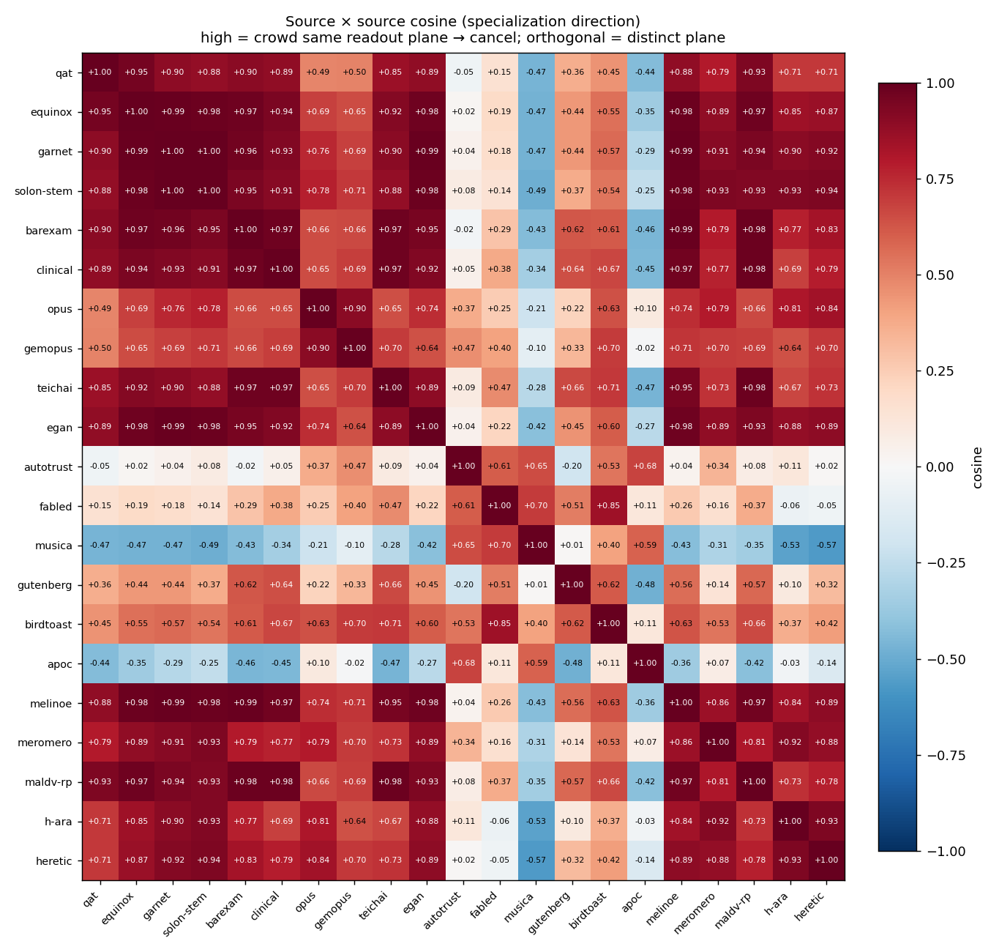
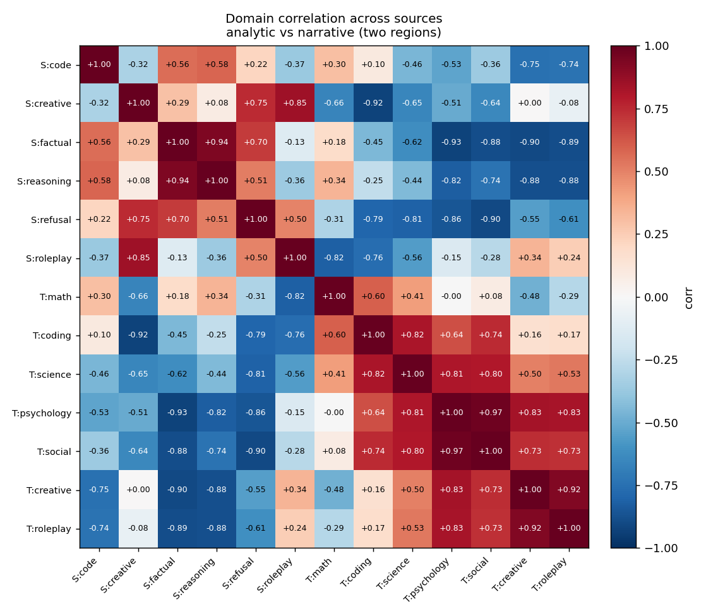
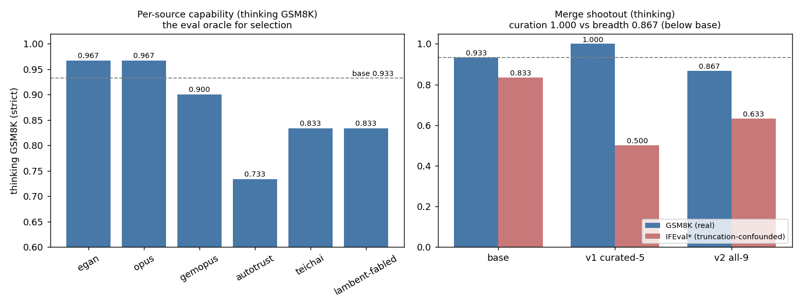

<pre>
  ____    _    _    ____    ____    ____    __  __   _____   ____    _____   _____ 
 / ___|  | |  | |  / _  \  |  _ \  |  _ \  |  \/  | |  ___| |  _ \  / ____| |  ___|
 \___ \  | |__| | | |_| |  | |_| | | | | | | |\/| | | |__   | |_| | | |  _  | |__ 
  ___) | |  __  | |  _  |  |    /  | |_| | | |  | | |  __|  |    /  | |_| | |  __|
 |____/  |_|  |_| |_| |_|  |_|\_\  |____/  |_|  |_| |_____| |_|\_\  \_____| |_____|
</pre>

# ShardMerge

A powerful tool for merging multiple finetuned LLM models by computing and combining their delta weights.

## Features

- Merge multiple finetuned models with their base model
- Efficient shard-based processing with minimal memory and disk footprint
- Concurrent downloads with progress tracking
- Support for HuggingFace model hub integration
- SafeTensors format support

## Installation

```bash
uv sync
```

## Usage

### Merge Models

Create a YAML configuration file:

```yaml
output_base_model: "unsloth/Meta-Llama-3.1-70B-Instruct"
output_dtype: "bfloat16"
finetune_merge:
  - { "model": "nvidia/Llama-3.1-Nemotron-70B-Instruct-HF", "base": "unsloth/Meta-Llama-3.1-70B-Instruct", "alpha": 0.3, "is_input": true }
  - { "model": "another/finetuned-model", "base": "unsloth/Meta-Llama-3.1-70B-Instruct", "alpha": 0.5, "is_output": true }
output_dir: "output_model"
device: "cuda"
clean_cache: false
cache_dir: "cache"
storage_dir: "storage"
```

Run the merge:

```bash
uv run python -m shard merge config.yaml
```

Options:
- `--verbose`: Enable detailed logging
- `--cache-dir PATH`: Override cache directory
- `--device cuda|cpu`: Override compute device

### Using Local Models

Set `storage_dir` to a directory containing your models to avoid re-downloading:

```yaml
storage_dir: "/home/user/models"
```

Models should be structured as `{storage_dir}/{org}/{model_name}/` with safetensors files and `model.safetensors.index.json`.

### Copy Model Configuration

Copy model config files from HuggingFace to a local directory:

```bash
uv run python -m shard copy-model config.yaml --revision main
```

### Generate Text

Run inference on a merged or local model:

```bash
uv run python -m shard generate ./output_model "Your prompt here" --max-tokens 512
```

Options:
- `--max-tokens N`: Maximum tokens to generate (default: 512)
- `--temperature F`: Sampling temperature (default: 0.7)
- `--top-p F`: Nucleus sampling parameter (default: 0.95)
- `--top-k N`: Top-k sampling parameter (default: 40)
- `-4` / `--load-in-4bit`: Load model in 4-bit precision
- `-8` / `--load-in-8bit`: Load model in 8-bit precision

### Extract ExLoRA Adapters

ExLoRA extracts a compact delta artifact from:

```text
Delta = W_target - W_base
```

It supports two artifact families:

- `lora`: PEFT-compatible SVD factors for the coherent super-floor signal.
- `nvfp4_residual`: dense NVFP4 delta map plus optional floor correction and sparse residual sidecar.

Run extraction with:

```bash
uv run python -m shard.exlora extract configs/my-exlora.yaml
```

The extractor writes an `EXTRACTION_REPORT.md` beside the artifact. The report includes per-layer ranks/errors plus summaries by module, depth bucket, and module x depth bucket.

#### Natural-Rank LoRA Config

Use this when a dense merged checkpoint contains a low-rank signal sitting above a full-rank storage floor, such as a bf16-merged LoRA:

```yaml
base_model: "path/to/base"
finetune_model: "path/to/bf16-merged-lora"
output_dir: "out/loras/merged-lora-natural"

artifact_type: "lora"

target_error: 0.00001
min_rank: 1
max_rank: 512
rank_policy: "error_or_signal"   # error | signal | error_or_signal
noise_floor_multiplier: 1.5
min_knee_drop: 1.25
tail_fraction: 0.25

target_modules: [q_proj, k_proj, v_proj, o_proj, gate_proj, up_proj, down_proj]

position_policy_enabled: true
position_early_fraction: 0.20
position_late_fraction: 0.75

device: "cuda"
dtype: "bfloat16"
storage_dir: "models"
cache_dir: "cache"
clean_cache: false
```

`rank_policy: error_or_signal` chooses the target-error rank unless the singular spectrum enters a credible floor before that point. In that case it stops at the detected super-floor head and records the reason as `noise_floor`.

Interpretation:

```text
rank ~60, reason=noise_floor, energy=0.10
```

means "about 60 directions stand above the floor"; it does not mean the whole tensor is reconstructed. The discarded floor must be checked behaviorally with activation error, hidden-state flux, or logit KL before trusting a LoRA-only artifact.

Do not use this as the default QAT artifact. The Gemma QAT behavior gate showed the counterexample: a detected rank head made logits worse than the base model, while dense NVFP4 closely matched the QAT model. A flat spectrum is only droppable when the behavioral gate proves the tail is inert.

#### NVFP4 Floor-Corrected Config

Use this when the dense floor carries behavior or when rank alone is not the right storage axis. This is the default branch for QAT survival maps unless a LoRA head passes the behavior gate:

```yaml
base_model: "google/gemma-4-31B-it"
finetune_model: "google/gemma-4-31B-it-qat-q4_0-unquantized"
output_dir: "out/delta-maps/gemma4-qat-nvfp4"

artifact_type: "nvfp4_residual"

nvfp4_extra_bpe: 1.0
nvfp4_residual_dtype: "bfloat16"
nvfp4_index_bits: 32
nvfp4_selection_policy: "floor_effect"       # residual_rms | floor_effect
nvfp4_floor_correction: "code_position_mean" # none | code_position_mean
nvfp4_floor_tolerance: 1.0
nvfp4_floor_effect_threshold: 2.0

target_modules: [q_proj, k_proj, v_proj, o_proj, gate_proj, up_proj, down_proj]

device: "cuda"
dtype: "bfloat16"
storage_dir: "models"
cache_dir: "cache"
clean_cache: false
```

This path does:

```text
Q = NVFP4(Delta)
E = Delta - Q
L_floor = robust level set of block RMS(E)
Q0 = floor-correct(Q, L_floor)
E0 = Delta - Q0
sidecar = selected super-floor blocks of E0
Delta_hat = Q0 + sidecar
```

`code_position_mean` stores a small correction table indexed by NVFP4 code and intra-block position. `floor_effect` spends residual sidecar bytes only on blocks whose corrected error rises above the fitted codec floor.

#### Position Diagnostics

Layer position is diagnostic because early, middle, and late layers usually carry different signal classes:

```text
early:  tokenizer repair, ingress cleanup, basis formation
middle: routing, transport, internal recoding
late:   output alignment and residual-to-lm_head cleanup
```

The report tags every tensor with:

```text
module_type
layer_index
depth_fraction
depth_bucket = early | middle | late | unknown
```

Use the module x depth summaries to decide whether a result is globally low-rank or only low-rank in certain regimes. Do not assume the MLP projections move together: `gate_proj`, `up_proj`, and `down_proj` can show different natural-rank/floor behavior by layer position, and any coupling between them should be treated as a validation question rather than a rank prior.

## Case study: selecting sources for a Gemma-4 task-vector merge

A merge is only as good as its **ingredient selection**. Throwing every available
finetune into one blend does not help — the isometric merge averages each source's
rotation on the orthogonal group, and sources that share weight-space directions
average *toward identity* and cancel. So the question is not "how many sources" but
"which sources occupy distinct, reinforcing directions." We answer it with two
measurement coordinates: **what each source delivers** (a capability eval) and
**where each source's energy lands** (a readout/domain-ownership scan), then select
on both.

The example below merges community Gemma-4-31B finetunes — Claude-Opus reasoning
distillations (`egan`, `opus-distill-v2`, `gemopus`), Fable-5 agentic distillations
(`autotrust`, `teichai`, `fabled`), benchmark SFTs (`qat`, `equinox`), and roleplay
tunes (`musica`, `meromero`, `apoc`) — onto `google/gemma-4-31B-it`. (Full writeup:
`research/ANTHROPIC_TASK_VECTOR.md`; figures regenerate via `scripts/plot_selection.py`.)

### 1. Where does each source's energy land? (domain specialization)

Each source is scored by how much its delta fires in each of seven base-thinking
domains, in the LM-head readout metric (`scripts/domain_ownership_map.py`). The
deviation from uniform is its *specialization*:



The benchmark SFTs (`qat`, `equinox`, `garnet`) are nearly flat — they lift
everything uniformly rather than tilting toward a domain. Everything else tilts
*creative/narrative* and *away from math* in readout space — including the reasoning
deltas, which is the first surprise (resolved in step 4).

### 2. Do they occupy distinct planes? (the crowding problem)

Cosine similarity of those specialization directions reveals the **interference
structure** — who will cancel whom:



Three blocks fall out: a **benchmark plane** (`qat`/`equinox`, anti-correlated with
everything, −0.5 to −0.7), a **roleplay-social plane** (`apoc`/`meromero`, +0.94 and
orthogonal to the core), and one large **capability supercluster** (`opus-distill`
… `gutenberg`, cosine +0.7 to +0.98). The catch: the *reasoning* deltas and the
*agentic/creative* deltas live in the **same** plane (`autotrust`↔`egan` +0.97).
They crowd the ~36-dimensional readout aperture, so a naive average of them cancels.
This is why source selection cannot simply "pick one reasoning + one agentic plane"
— in this geometry those are not separate planes.

The domains themselves collapse to two anti-correlated regions, confirming the
low-cardinality structure (analytic vs narrative, `coding`↔`roleplay` −0.96):



### 3. What does each source actually deliver? (the capability oracle)

Readout-firing is *not* capability. A 4-bit, deployment-faithful capability eval
(`scripts/run_eval.py`, GSM8K/IFEval, thinking + non-thinking channels) shows the
reasoning deltas beat base on thinking-math even though they read as "creative" in
step 1 — capability comes from reshaping intermediate computation, not from owning
the math readout direction:



`egan` and `opus-distill-v2` reach **0.967** (above base 0.933); the Fable agentic
tunes do not (their home is the non-thinking channel). This is the selection oracle:
**merge the sources the eval validates for the capability you want.**

### 4. The selection principle (curated vs broad — a shootout)

Two merges, *same operator* (readout-norm isometric, energy 1.1, tied head), differ
only in roster:

- **v1 — curated 5**: sign-coherent reinforcing sources *within* the capability plane
  (`gemopus`+`opus-distill` reinforce; `qat`+`melinoe`; +`fable5`). → thinking-GSM8K **1.000**.
- **v2 — all 9 reasoning**: every reasoning source. They crowd one plane and the
  rotation-average collapses (only 3–12 % of the summed delta survives). → **0.867,
  below base**.

(IFEval-thinking in the chart is marked `*` because we proved those low numbers are
**budget truncation**, not a format deficit — verbose reasoning over-runs the 4096-token
cap and the unclosed trace gets scored; see `research/ANTHROPIC_TASK_VECTOR.md`.)

**Curation beats breadth.** The lesson is not "fewer sources" but "do not pile
sign-incoherent sources into one crowded plane." Reinforce within a plane; keep
planes distinct. The open direction (a *v3*) is to **impose** the distinct planes the
geometry lacks — partition the readout aperture into orthogonal blocks and route each
task-pool into its own block, reinforcing within and isolating across — so a merge can
be both peaked (like v1) and broad (unlike v2).

## How It Works

1. Downloads model shards concurrently
2. Computes delta weights between base and finetuned models
3. Combines deltas efficiently using tensor operations
4. Writes output in compatible SafeTensors format

## License

LGPL-3.0 - See LICENSE.txt file for details.

## Contributing

Contributions welcome! Please feel free to submit pull requests.
